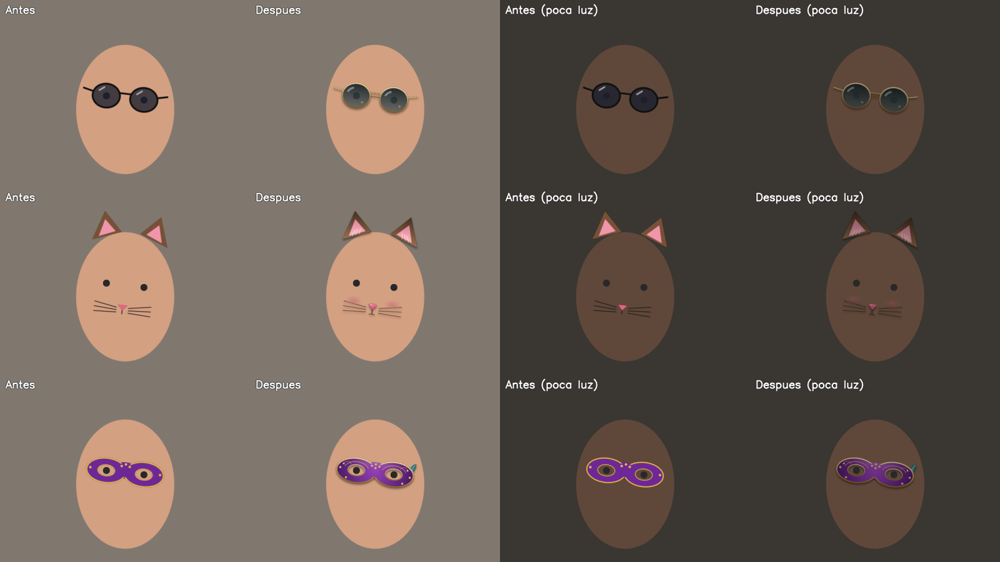

# Uso de IA en Nexora

En la propuesta pusimos una regla: **lo de clase es la base, y lo que no vimos en clase va marcado aparte y explicado, para poder defenderlo sin chuleta**. Este documento cumple esa regla para la segunda tanda de mejoras: el aspecto de la ventana y el filtro que se pone en la cara.

Aquí se explica qué hemos hecho con ayuda de IA, por qué, qué parte del código de clase **no** se ha tocado y cómo se comprueba cada cosa.

## Cómo hemos usado la IA

- **Herramienta**: un asistente de programación con IA (Claude Code), trabajando sobre este mismo repositorio.
- **Qué le pedimos**: que mejorara la interfaz y el filtro de la cara **sin tocar lo que hicimos con los apuntes de clase**, y que dejara marcado y explicado todo lo nuevo.
- **Qué hizo la IA**: propuso el diseño, escribió el código nuevo y las pruebas automáticas, y redibujó los PNG con nuestro propio script.
- **Qué hacemos nosotros**: revisar cada cambio, probarlo en Windows con la webcam, rellenar las medidas de [`Pruebas.md`](Pruebas.md) y decidir si se queda.

Todo lo que ha hecho la IA lleva una marca en el código para encontrarlo rápido:

- `[Ampliación con uso de IA]` en la explicación de la clase o del método.
- `[IA]` en los comentarios de las líneas sueltas.

Para verlas todas:

```bash
git grep -n "\[IA\]\|Ampliación con uso de IA"
```

## Lo que no hemos tocado

Estas partes salen de los apuntes de clase y se han quedado **exactamente igual**:

| Parte | Archivo | Por qué no se toca |
|---|---|---|
| Detector de cara y ojos (Haar Cascade, 1,1, 4 vecinos, 80×80) | `Vision/DetectorCaras.cs` | Es el detector de clase. El filtro nuevo usa lo que devuelve, no lo cambia. |
| Lectura de la cámara (`VideoCapture`, `Read`, `CvtColor`) | `Servicios/ServicioCamara.cs` | El recorrido de cada imagen es el de clase. |
| Recuadros y ayudas encima de la imagen (`Rectangle`, `Circle`) | `Vision/Dibujante.cs` | Igual que en las prácticas. |
| Voz (`Choices`, `GrammarBuilder`, 60 %, «sí»/«no») | `Servicios/ServicioVoz.cs`, `Voz/InterpreteOrdenes.cs` | Es el servicio de voz de clase. |
| Cursor con zona muerta y suavizado | `Cursor/ControlCursor.cs`, `Utilidades/SuavizadorPunto.cs` | Ejercicio de la cabeza de clase. |
| Estructura MVVM (servicios con eventos, propiedades y comandos) | `ViewModels/MainViewModel.cs` | Solo se le **añade** una propiedad (`FiltroRealista`); ninguna línea de clase cambia. |
| Los `Binding` de la ventana | `Views/MainWindow.xaml` | Son los mismos de antes, uno a uno. Solo cambia cómo se ven. |
| Las cuentas para colocar el filtro («los ojos hacen de regla y de transportador») | `Vision/GeometriaFiltro.cs` | No cambia. Las 46 pruebas que ya había siguen pasando. |

En `ServicioCara.cs` (que junta el detector de clase con el filtro) solo se ha cambiado **una llamada**: en vez de pintar el filtro directamente, pasa por el estabilizador. La línea antigua está copiada en un comentario al lado.

## 1. El filtro de la cara

Antes el filtro funcionaba, pero se notaba que era una pegatina: parpadeaba cuando Haar perdía la cara una imagen suelta, con poca luz brillaba más que la cara y no tenía volumen. Le hemos hecho cuatro mejoras. Las tres primeras se pueden apagar con el interruptor **Filtro realista** para comparar en las pruebas.



*Imagen generada con el propio `AplicadorFiltros` sobre una cara dibujada, no con la webcam.*

### 1.1 Sin parpadeo: el filtro aparece y desaparece suave

- **Archivo**: `Vision/EstabilizadorFiltro.cs` (nuevo).
- **Problema**: Haar a veces falla en una imagen (un parpadeo, la cabeza algo girada). En esa imagen el filtro desaparecía y en la siguiente volvía.
- **Qué hace**: si se pierde la cara, el filtro se queda en el último sitio bueno y se va haciendo transparente en 10 imágenes (unos 330 ms). Si la cara vuelve antes, ni se nota. Cuando la cara aparece, el filtro sube de transparente a opaco en 4 imágenes.
- **Por qué así**: son solo dos sumas y una resta por imagen. No toca el detector y se puede probar sin cámara.
- **Si nos preguntan**: «Haar a veces falla una imagen suelta. En vez de borrar el filtro de golpe, lo dejamos donde estaba y lo vamos apagando poco a poco. Si la cara vuelve enseguida, no se nota nada».

### 1.2 Sombra suave debajo del filtro

- **Archivo**: `Vision/AplicadorFiltros.cs`, método `PintarSombra`.
- **Qué hace**: vuelve a hacer el `WarpAffine` del PNG, pero unos píxeles más abajo. Se queda solo con el canal alfa (la silueta), lo difumina con `GaussianBlur` y oscurece la imagen ahí: `fondo · (1 − 0,38 · silueta)`.
- **Por qué así**: es el mismo `WarpAffine` que ya usábamos. La sombra crece y encoge con la cara porque se mide como una fracción del ancho del filtro.
- **Funciones nuevas de OpenCV**: `GaussianBlur`, `ExtractChannel`.
- **Si nos preguntan**: «Es el mismo PNG, bajado un poco, borroso y en negro transparente. Hace que parezca que las gafas están encima de la cara y no pintadas en ella».

### 1.3 El filtro se adapta a la luz

- **Archivo**: `Vision/AplicadorFiltros.cs`, métodos `AjustarALaLuz` y `FactorLuz`.
- **Qué hace**: mide el brillo medio de la cara justo debajo del filtro (gris + `Mean` con el alfa como máscara). Si está por debajo de 135, multiplica los colores del filtro por `√(brillo / 135)`, entre 0,55 y 1. El alfa no se toca.
- **Por qué así**: con poca luz la cara se ve oscura y el filtro no, y se nota que está pegado. La raíz cuadrada hace que el cambio sea suave y que el filtro nunca se vuelva negro.
- **Funciones nuevas de OpenCV**: `Mean` con máscara, `Threshold`, `CountNonZero`.
- **Si nos preguntan**: «Miramos cuánta luz tiene la cara y oscurecemos el filtro en la misma proporción, para que parezca que está en la misma habitación».

### 1.4 Dibujos nuevos de los filtros

- **Archivo**: `herramientas/generar_filtros.py` (versión 2) y los tres PNG.
- **Qué cambia**: degradados en los cristales y en el antifaz, montura de metal con brillo, reflejos curvos, orejas con pelito y coloretes, filigranas, lentejuelas y una pluma en el antifaz.
- **Lo importante**: los ojos siguen en las mismas coordenadas (x = 180 y x = 460), así que `CatalogoFiltros` y las cuentas de colocación **no cambian**, y las pruebas de `GeometriaFiltroTests` siguen pasando sin tocarlas.
- **Si nos preguntan**: «Los dibujamos con un script de Python en vez de bajarlos de internet, para no tener problemas de derechos de autor. La versión nueva solo añade degradados y detalles; los ojos están donde siempre».

### Cómo se comprueba

- `dotnet test`: 54 pruebas (las 46 de antes y 8 nuevas en `EstabilizadorFiltroTests.cs`).
- En la ventana: apagar y encender **Filtro realista** y comparar. En [`Pruebas.md`](Pruebas.md) hay una tabla para apuntar si cambian los FPS.

## 2. La interfaz

- **Archivos**: `App.xaml` (colores, letras y plantillas) y `Views/MainWindow.xaml` (cómo se colocan las cosas).
- **Qué no cambia**: los `Binding`, los comandos y el MVVM. Un compañero que conozca la versión de clase encuentra cada interruptor en el mismo sitio del ViewModel.

### Las decisiones de diseño, y por qué

| Decisión | Por qué |
|---|---|
| Fondo gris neutro y frío, no oscuro | Los programas de fotografía usan gris neutro para no "teñir" la imagen. Además, el fondo azul marino con un único color cian es lo que sale por defecto en casi todas las plantillas, y queríamos que Nexora se pareciera a un aparato, no a una web. |
| Un color por módulo: mano cobalto, cara ciruela y voz ocre | El color dice de qué módulo es cada cosa. El interruptor encendido, el historial y el gesto actual usan el color de su módulo. |
| Rojo solo para el piloto de la cámara | Es el piloto de "grabando" de cualquier cámara. Si el rojo saliera en más sitios, perdería el significado. |
| Letra Bahnschrift para títulos y números | Viene instalada con Windows 10 y 11 (no hay que meter archivos de letra) y es la DIN de las señales: los números se leen bien de un vistazo. |
| La cámara es un visor con marcas en las esquinas | Es lo más importante de la ventana, así que ocupa el centro y se parece al visor de una cámara. |
| Las medidas en una sola barra con números grandes | Son las que hay que apuntar en las pruebas, así que se tienen que leer de lejos. |
| Panel derecho en una columna con líneas finas, sin tarjetas | Las tarjetas sueltas con sombra son otro "tic" de plantilla. Con líneas el panel se lee de arriba abajo, como un formulario. |
| Los filtros se eligen viendo su dibujo | Es más rápido reconocer unas gafas que leer «Gafas». El dibujo es el mismo PNG que se pone en la cara. |
| Una sola animación: la bolita del interruptor (120 ms) | Solo se mueve algo cuando lo pulsas, para que se vea qué ha cambiado. Nada se mueve por su cuenta. |
| Borde azul al moverse con el tabulador | Para poder usar la ventana con el teclado. |

### Si nos preguntan

«La estructura es la de clase: un ViewModel con propiedades y comandos, y la ventana solo hace Binding. Lo que hemos cambiado con la ayuda de la IA son los estilos, que en WPF se cambian con `ControlTemplate`, igual que el interruptor que ya teníamos. Cada color significa algo: azul la mano, ciruela la cara, ocre la voz».

## Resumen

| Mejora | Origen | Archivos | ¿Toca código de clase? |
|---|---|---|---|
| Aparecer y desaparecer suave del filtro | Ampliación con uso de IA | `EstabilizadorFiltro.cs`, `ServicioCara.cs` | No (una llamada cambiada en el servicio que junta las piezas) |
| Sombra del filtro | Ampliación con uso de IA | `AplicadorFiltros.cs` | No |
| Ajuste a la luz | Ampliación con uso de IA | `AplicadorFiltros.cs` | No |
| Dibujos nuevos de los filtros | Ampliación con uso de IA | `generar_filtros.py`, PNG | No |
| Interruptor «Filtro realista» | Ampliación con uso de IA | `AjustesNexora.cs`, `MainViewModel.cs` | Solo añade una propiedad |
| Rediseño de la ventana | Ampliación con uso de IA | `App.xaml`, `MainWindow.xaml` | No (los Binding son los mismos) |
